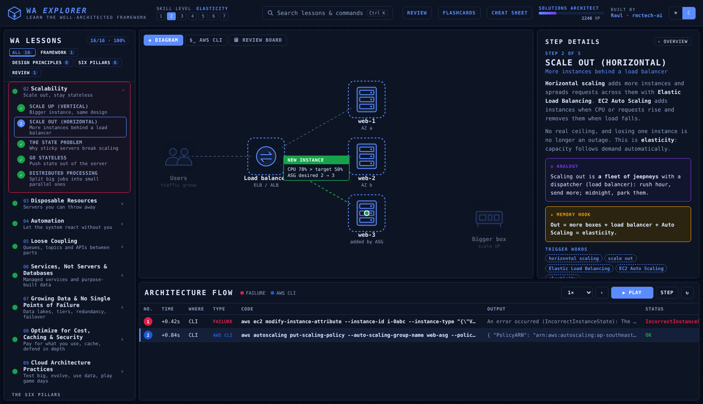

# 🏛️ Well-Architected Explorer — Learn the AWS Well-Architected Framework and its design principles

An interactive, step-by-step course on the **AWS Well-Architected Framework** for Cloud Engineers and future Solutions Architects: the 16 cloud design principles (scalability, disposable resources, automation, loose coupling, services not servers, the right database, data growth, no single points of failure, cost, caching, security, and the cloud practices from production-scale testing to game days), then each of the **six pillars** with its own design principles, key services and exam traps, and finally how a real **Well-Architected Review** works. Every lesson animates how an architecture behaves, with analogies, memory hooks, trigger words, quizzes, and a **Review Board lab** where you describe a workload in YAML and fix its high-risk issues pillar by pillar.

> Created by **Raul** ([@rmctech-ai](https://github.com/rmctech-ai)) · Freelance AI Automation Specialist on the path to Cloud Security.
> Part of the Explorer series: [Linux Explorer](https://github.com/rmctech-ai/linux-explorer) · [Python Explorer](https://github.com/rmctech-ai/python-explorer) · [IAM Explorer](https://github.com/rmctech-ai/iam-explorer) · [VPC Explorer](https://github.com/rmctech-ai/vpc-explorer) · [IaC Explorer](https://github.com/rmctech-ai/iac-explorer) · [Serverless Explorer](https://github.com/rmctech-ai/serverless-explorer) · [CI/CD Explorer](https://github.com/rmctech-ai/cicd-explorer) · [Cloud Security Explorer](https://github.com/rmctech-ai/cloudsecurity-explorer) · [Security Journey Explorer](https://github.com/rmctech-ai/aws-security-journey) · [n8n Explorer](https://github.com/rmctech-ai/n8n-explorer) · [Claude Code Explorer](https://github.com/rmctech-ai/claudecode-explorer).
> 🏠 Part of **[Raul's Cloud Learning Hub](https://rmctech-ai.github.io/)** · Live course: https://rmctech-ai.github.io/WellArchitected-Explorer/
> The Explorer course format is inspired by [Protocol Explorer](https://protocol-explorer-alpha.vercel.app/) by Dilum Sanjaya. All lessons, labs and study tools are my own work.



---

## ▶ Run it

No build step. Plain HTML/CSS/JS.

```bash
python3 -m http.server 8000     # then open http://localhost:8000
```

### Publish on GitHub Pages
```bash
git init && git add . && git commit -m "Well-Architected Explorer"
git branch -M main
git remote add origin https://github.com/rmctech-ai/wellarchitected-explorer.git
git push -u origin main
```
GitHub → **Settings → Pages → Deploy from a branch → `main` / root → Save** → `https://rmctech-ai.github.io/wellarchitected-explorer/`

---

## 🧭 How to use it

| Area | What it does |
|---|---|
| **Lessons** (left) | 16 lessons grouped by track. Click to expand steps. Dots show progress. |
| **Diagram** tab | Animated scene for every step. |
| **$_ AWS CLI** tab | Types out real commands/code for the step with realistic output. |
| **🏛 REVIEW BOARD** tab | **Review Board**: describe a workload in YAML (components such as `ec2`, `alb`, `rds`, `dynamodb`, `sqs`, `cloudfront`, plus links, operations, security and cost settings) and press RUN REVIEW. Like the AWS Well-Architected Tool, the board checks the design against the six pillars and reports high, medium and low risk issues with a fix for each and a score per pillar. Each challenge asks you to remove specific risks without breaking anything else. |
| **Step Details** (right) | Explanation, **Analogy**, **Memory Hook**, **Trigger Words**, real-world notes, warnings. |
| **Architecture Flow** (bottom) | Log of every command so far with type, output and status. |
| **XP & levels** | Earn XP for steps, lessons, quizzes and challenges. Saved in your browser. |
| **Cheat Sheet** | Master hooks + key syntax for every lesson (also [`CHEATSHEET.md`](CHEATSHEET.md)). |

**Keyboard:** `→` / `←` steps · `Space` play · `Ctrl+K` search · `Esc` close.

---

## 📚 Curriculum (16 lessons · 80 steps · 64 quiz questions · 16 hands-on challenges)

| # | Lesson | Track | You'll learn |
|---|---|---|---|
| 01 | What is Well-Architected? ⚑ | FRAMEWORK | Six pillars, one way to judge a design |
| 02 | Scalability ⚑ | DESIGN PRINCIPLES | Scale out, stay stateless |
| 03 | Disposable Resources ⚑ | DESIGN PRINCIPLES | Servers you can throw away |
| 04 | Automation ⚑ | DESIGN PRINCIPLES | Let the system react without you |
| 05 | Loose Coupling ⚑ | DESIGN PRINCIPLES | Queues, topics and APIs between parts |
| 06 | Services, Not Servers & Databases ⚑ | DESIGN PRINCIPLES | Managed services and purpose-built data |
| 07 | Growing Data & No Single Points of Failure ⚑ | DESIGN PRINCIPLES | Data lakes, tiers, redundancy, failover |
| 08 | Optimize for Cost, Caching & Security ⚑ | DESIGN PRINCIPLES | Pay for what you use, cache, defend in depth |
| 09 | Cloud Architecture Practices ⚑ | DESIGN PRINCIPLES | Test big, evolve, use data, play game days |
| 10 | Pillar 1: Operational Excellence ⚑ | SIX PILLARS | Run it, watch it, improve it |
| 11 | Pillar 2: Security ⚑ | SIX PILLARS | Identity, traceability, layers, data, response |
| 12 | Pillar 3: Reliability ⚑ | SIX PILLARS | Recover automatically, scale out, plan DR |
| 13 | Pillar 4: Performance Efficiency ⚑ | SIX PILLARS | Right resources, global, serverless, experiment |
| 14 | Pillar 5: Cost Optimization ⚑ | SIX PILLARS | Value at the lowest price point |
| 15 | Pillar 6: Sustainability ⚑ | SIX PILLARS | Less energy and waste per unit of work |
| 16 | Run a Well-Architected Review ⚑ | REVIEW | From questions to an improvement plan |

⚑ = has a hands-on challenge.

## 🎯 Study plan & capstone

- **Week 1:** Lessons 1–7 (the framework, then the 16 design principles). Solve every Review Board challenge.
- **Week 2:** Lessons 8–13 (the six pillars, one per day, with their design principles and key services).
- **Week 3:** Lesson 14 (running a Well-Architected Review), then re-review the lab's starter workload until it scores 100.

**Capstone:** Take one design you know (for example InvoiceIQ or an Architecture Atlas case), describe it in the Review Board, fix every high-risk issue, then write a one-page review: risks found, fixes, and the trade-offs you accepted per pillar. Optionally, define the same workload in the free AWS Well-Architected Tool and compare.

## License
MIT © 2026 Raul (rmctech-ai)
